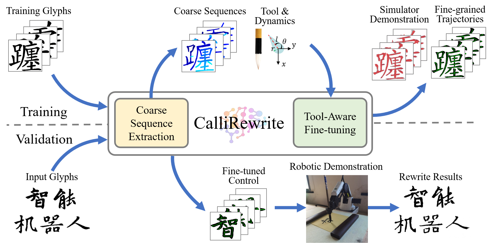

<h2 align="center">
  <b>CalliRewrite: Recovering Handwriting Behaviors from Calligraphy Images without Supervision</b>

  <b><i>ICRA 2024</i></b>


<div align="center">
    <a href="https://arxiv.org/abs/2405.15776" target="_blank">
    </a>
    <a href="https://luoprojectpage.github.io/callirewrite/" target="_blank">
    </a>
    <a href="http://igcl.pku.edu.cn/papers/24/ICRA2024_CalliRewrite_LYX.pdf" target="_blank">
    </a>
</div>
</h2>

This is the repository of [**CalliRewrite: Recovering Handwriting Behaviors from Calligraphy Images without Supervision**](http://igcl.pku.edu.cn/papers/24/ICRA2024_CalliRewrite_LYX.pdf).

CalliRewrite is an unsupervised approach enabling low-cost robotic arms to replicate diverse calligraphic 
glyphs by manipulating different writing tools. We use fine-tuned unsupervised LSTM to perform coarse stroke segmentation, and refine them through a reinforcement learning method to produce 
fine-grained control.

For more information, please visit our [**project page**](https://luoprojectpage.github.io/callirewrite/).




## 📬 News
- **2024.4.25** Coarse Sequence Extraction checjpoints released.
- **2024.4.6** CalliRewrite has been selected as a finalist for the IEEE ICRA Best Paper Award in Service Robotics
- **2024.2.27** Version 1.0 upload

## How to Use Our Code and Model:
We are releasing our network and checkpoints. The weights for the coarse sequence module are stored in [**this repository**](https://drive.google.com/file/d/1PUghb8WizEOYHYIAdBluwQMbTeRlBqF1/view?usp=sharing). You can download and place them in the folder ./outputs/snapshot/new_train_phase_1 and ./outputs/snapshot/new_train_phase_2. The parameters of the SAC model are learned based on the provided textual images; therefore, they vary depending on the different tools and input texts."

You can setup the pipeline under the following guidance.

### 0. Install dependencies
Due to package version dependencies, we need to set up two separate environments for coarse sequence extraction and tool-aware finetuning. To do this, you can follow these steps:

1. Navigate to the directory for coarse sequence extraction:
   ```bash
   cd seq_extract
   ```

2. Create a new conda environment using the specified requirements file:
   ```bash
   conda env create -f environment.yml
   ```

3. Activate the newly created environment (optional):
   ```bash
   conda activate calli_ext
   ```
   
4. Navigate to the directory for sequence fine-tuning:
   ```bash
   cd ../rl_finetune
   ```

5. Create another new conda environment using the requirements file for fine-tuning:
   ```bash
   conda env create -f environment.yml
   ```

6. Activate the second newly created environment:
   ```bash
   conda activate callli_rl
   ```
   
7. Follow **modify_env.md** and correct some flaws in the packages (Necessary!):
   

By following these steps, you will have two separate conda environments configured for coarse sequence extraction and sequence fine-tuning, ensuring that the correct dependencies are installed for each task.

### 1. Caliberate your own writing utensil

We provide three simple tools for modeling in the reinforcement learning environment: **Calligraphy brush**, **fude pen**, and **flat tip marker**. The geometry and dynamic properties are defined in `./rl_finetune/Callienv/envs/tools.py` and folder `./rl_finetune/tool_property/`.  You can also define your own utensil easily.


For robotic demonstration, we provide a jupyter notebook in `./callibrate/callibrate.ipynb`. It clearly demonstrates the whole process to find out the $r-z$ correspondence on Dobot Magician robotic arm. Remember this step is crucial for it bridges the sim2real gap and may affect the rewriting result.

### 2. Download pretrained models

### 3. Coarse Sequence Extraction

#### Training
We conduct a two-phase progressive training, for the first phase we train on QuickDraw Dataset, you can simply run the shell command:
   ```bash
   conda activate calli_ext
   cd seq_extract
   ```
Then you can train the two-phase model with your owncollected fine-tuned data:
   ```bash
   bash ./train.sh
   ```

#### Testing with Trained Models
For example, test the model saved in "outputs/snapshot/new_train_phase_2" on images in the "imgs" folder:

 ```bash
 python ./test.py --input imgs --model new_train_phase_2
 ```

### 4. Tool-Aware Finetuning

You can call the function to easily move inferenced sequences along with the images to `./rl_finetune/data/train_data' and `./rl_finetune/data/test_data'. Remember the number of train/test envs must be a divisor of the number of train/test data.
   ```bash
   conda activate calli_rl
   cd ..
   python move_data
   cd rl_finetune
   ```
Then you can have an easy startup:
   ```bash
   bash ./scripts/train_brush.sh
   ```

### 5. Visualization and robotic demonstration

---

## RoboFab Calligraphy Simulator (ISDN5240 Group Project)

The `robofab_sim/` module adds an interactive Viser simulator with a Franka Panda
arm, deformable brush, and Xuan paper canvas. It supports three input modes:

| Mode | Flag | Input |
|------|------|-------|
| Stage 1/2 — built-in chars | _(none)_ | dropdown: yong / yi / ren / zhong / shan |
| Stage 3 — KanjiVG | `--char 福` | any CJK character in KanjiVG database |
| Stage 3 — CalliRewrite | `--npz path.npz` | seq_extract output `.npz` file |

### Quick Start

```bash
# 1. Create Python 3.11 venv and install deps
uv venv .venv --python 3.11
uv pip install --python .venv/bin/python viser yourdfpy robot_descriptions Pillow numpy

# 2. Download KanjiVG data (~30MB, one-time)
bash robofab_sim/data/download_kanjivg.sh

# 3. Run simulator (Stage 1/2 built-in chars)
.venv/bin/python robofab_sim/calligraphy_sim.py

# 4. Run with any CJK character (Stage 3 — KanjiVG)
.venv/bin/python robofab_sim/calligraphy_sim.py --char 福

# 5. Full pipeline: image → CalliRewrite → Viser (one command)
bash infer.sh 福
```

Then open `http://localhost:8080` in a browser (Chrome/Firefox — VS Code's
embedded browser does not support WebGL). Click **Replay Character** to write.

### seq_extract Inference (optional, requires TensorFlow)

```bash
# Separate Python 3.8 + TF 2.10 environment for seq_extract
uv venv seq_extract/.venv --python 3.8
uv pip install --python seq_extract/.venv/bin/python \
    "tensorflow==2.10.0" "opencv-python==4.9.0.80" \
    "tensorflow-io-gcs-filesystem==0.34.0" \
    pillow numpy scipy six matplotlib imageio scikit-image gizeh cairocffi

# Download pretrained weights (244MB) → place in:
#   seq_extract/outputs/snapshot/new_train_phase_1/
#   seq_extract/outputs/snapshot/new_train_phase_2/
# Google Drive: https://drive.google.com/file/d/1PUghb8WizEOYHYIAdBluwQMbTeRlBqF1/view

# Run inference
CUDA_VISIBLE_DEVICES=0 seq_extract/.venv/bin/python seq_extract/test.py \
    --input seq_extract/sample_inputs/yong_dir --model new_train_phase_2

# Feed result into Viser
.venv/bin/python robofab_sim/calligraphy_sim.py \
    --npz seq_extract/outputs/sampling/__new_train_phase_2/seq_data/yong_test.npz
```

## Citation
```
@article{luo2024callirewrite,
  title={CalliRewrite: Recovering Handwriting Behaviors from Calligraphy Images without Supervision},
  author={Luo, Yuxuan and Wu, Zekun and Lian, Zhouhui},
  journal={arXiv preprint arXiv:2405.15776},
  year={2024}
}
```
