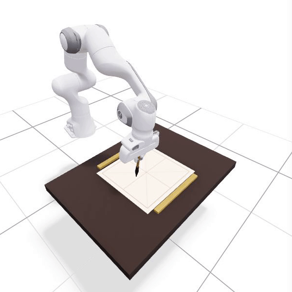
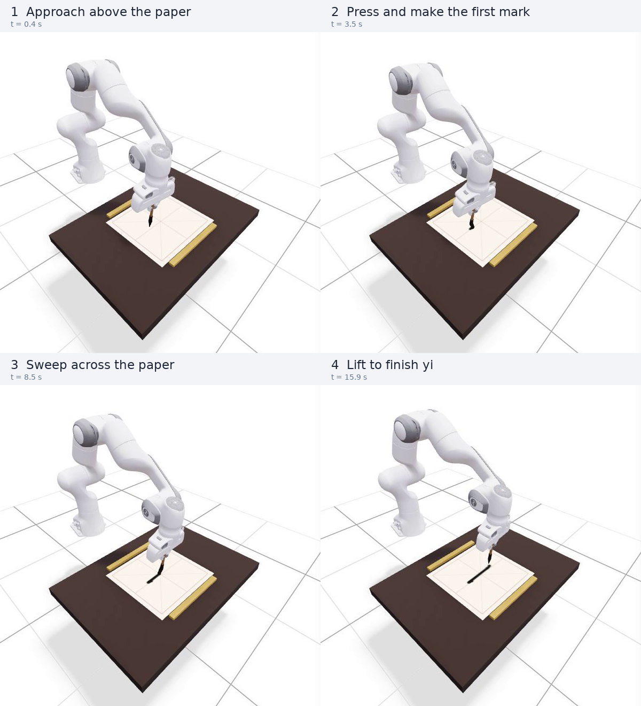
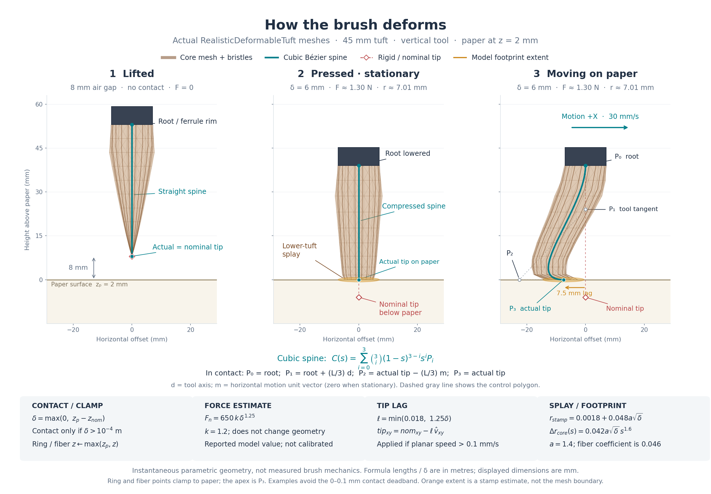

# Panda calligraphy viewer

This folder is a custom 3D add-on: a Franka Panda arm, a deformable brush mesh and an ink canvas displayed in a browser with Viser. It runs independently of the official CalliRewrite code. The official tool-aware simulation lives in [`../rl_finetune/`](../rl_finetune/); this viewer uses its own kinematics and hand-written trajectories.

**This viewer does not load the pretrained extraction checkpoints or a trained SAC policy.** Its implemented characters are `yong` (永, eight stroke groups) and `yi` (一, one stroke group). The source header also mentions 福 and 中, but they are not present in the trajectory dictionary.

## Launch with the existing environment

Run these commands in a terminal on the computer hosting the repository:

```bash
cd /data/CalliRewrite/panda_calligraphy
env -u PYTHONPATH -u PYTHONHOME PYTHONNOUSERSITE=1 \
  ./venv/bin/python -u calligraphy_panda_viser_sim.py
```

Open the HTTP URL printed by Viser, usually **http://localhost:8080**. If that port is occupied, Viser tries another port; use the URL from this run's terminal output. Successful startup prints both `URDF and meshes loaded successfully` and `[READY] Franka Panda Calligraphy Simulator is running!`.

The script has **no command-line argument parser**: there are no `--port`, `--model`, `--input` or `--help` options. Set the character and parameters in the browser. Stop the server with **Ctrl+C** in its terminal.

The command above clears inherited ROS/Conda Python paths while using this folder's Python environment. A CUDA GPU, the extraction environment and the RL environment are not required.

## What to expect

The live browser view contains the Panda robot, a dark table, Xuan paper with a red guide grid, paperweights and the brush. Orbit and zoom the 3D view to inspect the tuft and paper. Playback moves the joints through inverse kinematics; contact deforms the tuft and deposits ink on the canvas.

For a short first run:

1. Open **Calligraphy Trajectory Execution** and press **Reset Arm Pose**.
2. Select **yi**, then press **Wash Paper (Clear)** under **Tuft & Xuan Paper Physics**.
3. Press **Execute Character (Write)** and watch the arm and ink trail. The same button pauses/resumes playback and becomes **Replay Character** after completion.
4. Try **yong** for the longer eight-group trajectory. Reset the arm and clear the paper before changing characters.

## Watch the Panda draw `yi` in Viser

This is a **recording of the actual Viser browser view**, captured on October 26, 2026 with **Character = yi**, **Writing Speed = 0.2**, and **Loop Playback off**. It shows the arm lowering the brush, making contact, sweeping across the paper, and lifting after the stroke. The animation crops the 3D viewport for clarity; the simulator source was unchanged.



The four stages below are frames from that same continuous run:



| Stage | What the viewer is doing |
| --- | --- |
| **1. Approach** | IK moves the nominal tip toward the first waypoint above the paper. |
| **2. Press** | The nominal tip moves below the paper plane; the contact model bends and splays the tuft and starts the ink trail. |
| **3. Sweep** | The arm follows the built-in waypoint path while the contact tip deposits ink. |
| **4. Lift** | The final waypoint raises the nominal tip to 25 mm in world Z, leaving the stroke on the paper. |

To reproduce the sequence, follow the launch command above, select **yi**, reset the arm, clear the paper, set **Writing Speed** to **0.2**, then press **Execute Character (Write)**. Leave it running continuously to see the motion-dependent brush lag. At this speed the seven interpolated waypoint segments take roughly 16 seconds; the recording includes a short completed-state hold. Frame labels are approximate seconds from the recording start.

The built-in `yi` path sweeps mainly along **world Y** while world X stays near 0.55 m. Its apparent direction depends on the camera. The flat `XuanPaperCanvas` image maps world Y to image rows, so its raw raster appears vertical. The live recording keeps the captured camera view; the component overview below rotates the canvas 90° counterclockwise and labels its Panda-base coordinates so `yi` reads horizontally.

View the [full browser screenshot with the controls](docs/viser_yi_finished.jpg), [full-view MP4 recording](docs/viser_yi_recording.mp4), or [capture details](docs/viser_yi_capture.json). This demonstrates the hand-written trajectory player; it does not evaluate a learned CalliRewrite or SAC policy.

## How the deformable brush works

This separate diagram uses **actual meshes and bristle segments returned by `RealisticDeformableTuft`**. It compares a lifted brush, a stationary press, and a moving press. A vertical tool and motion along +X are used to make the deformation easy to see; the live Panda uses the orientation from its own forward kinematics.



- **Contact and compression:** the paper is at world Z = 2 mm. Compression is the difference between that plane and the nominal rigid tip height; contact starts when compression exceeds 0.1 mm. In contact, the actual tip is placed on the paper. The nominal tip marker below the paper is a reference, not the rendered contact position.
- **Bending and drag:** a cubic Bézier spine connects the ferrule/root to the actual tip. During horizontal motion, the contact tip lags opposite the direction of travel. The surrounding lofted mesh and individual bristle lines follow that spine; their sampled points are clamped to the paper plane.
- **Splay and stroke width:** increasing compression expands the lower tuft and the returned circular ink-footprint radius. With the default parameters, the diagram's 6 mm compression gives a **7.01 mm footprint radius**; moving at 30 mm/s adds **7.5 mm tip lag**. The orange footprint is a stamp estimate, rather than the exact mesh boundary.
- **Force estimate:** the same example returns about **1.30 N**. This is a parametric model output, not a calibrated force measurement. The stiffness slider changes this estimate; it does not change the mesh or footprint geometry.

The source computes this contact geometry afresh each tick, without integrating bristle mass or a robot force/torque solver. The canvas stamps the footprint at the actual contact tip. Its force-dependent alpha is discarded by the current RGB conversion before display, and **Paper Absorbency** changes an outline radius rather than solving fluid diffusion. See the [SVG version](docs/brush_deformation_explained.svg), [exact numerical examples](docs/brush_deformation_metrics.json), and [regeneration instructions](docs/README.md#regenerate-the-brush-diagram).

### Additional component overview


The arm/table panel uses the latest **actual Viser capture**, preserving the scene's depth and placement. The completed `yi` canvas is rotated **90° counterclockwise**: **+Y of the Panda base frame runs rightward**, and **+X runs upward**. The robot base and world frames coincide in this simulator; the paper axes are labelled in metres. This presentation change leaves the simulated trajectory and robot pose unchanged. The scene capture, completed replay and contact detail show separate moments. See the [media guide and regeneration command](docs/README.md#component-overview).

## Browser controls

| Control | Implemented behavior |
| --- | --- |
| **Character** | Selects `yong` or `yi`. Selection alone does not reset playback indices or clear the paper. |
| **Execute Character (Write)** / **Pause Writing** / **Resume Writing** | Toggles playback. |
| **Step Stroke** | Pauses, advances the stroke index and resets its interpolation position. Press Resume to play that stroke; this button does not execute an entire stroke by itself. |
| **Reset Arm Pose** | Stops playback, resets stroke indices and restores the nominal arm configuration. It does not clear ink. |
| **Writing Speed** | Changes interpolation speed from 0.2 to 3.0; default 1.0. |
| **Loop Playback** | Restarts after the last stroke and clears the canvas between loops. |
| **Tip X / Tip Y / Tip Z** | Requests a Cartesian tip position through IK while playback is paused. Negative nominal Z compresses the soft tuft against the paper. |
| **Touch Paper (Z=0)** | Despite its label, sets the requested tip Z to **0.001 m**. The paper plane is at **0.002 m**. |
| **Lift Brush (Z=35mm)** | Sets the requested tip Z to 0.035 m. |
| **panda_joint1 … panda_joint7** | Direct joint adjustment while paused, with the limits defined in the script. |
| **Bristle Stiffness** | Changes the contact-force estimate; default 1.2. |
| **Splay Factor (铺毫)** | Changes tuft expansion and contact footprint; default 1.4. |
| **Paper Absorbency** | Changes the raster bleed outline; default 0.7. |
| **Wash Paper (Clear)** | Clears ink and redraws the guide grid. |
| **Dip Ink (100%)** | Resets `ink_level`; the current drawing loop does not consume that value, so this has no visible effect. |

The contact model clamps tuft vertices to the paper plane, estimates normal force, adds motion-dependent tip lag and widens the footprint under compression. Arm motion uses position-based damped least-squares IK. This is an interactive geometric/contact demonstration; it does not run a rigid-body robot dynamics engine, torque control or robot/table collision checking.

## Inputs and outputs

The running pipeline is:

```text
built-in waypoint coordinates
  -> smooth interpolation
  -> Panda position IK and forward kinematics
  -> deformable tuft/contact estimate
  -> ink stamps on a 1024 x 1024 canvas
  -> robot, brush and paper updates in Viser
```

Only the first three values of each waypoint are used for XYZ motion. Pressing is derived from the nominal tip's height relative to the paper; the fourth waypoint value is not read by the playback loop.

There is no image/checkpoint input option and **no automatic PNG, video, trajectory or policy export**. Ink lives in memory for the current server session. The PNG in `docs/` is a documentation asset, not a file generated whenever you launch the viewer.

## Re-create the environment in a fresh checkout

The local `venv/` already exists and was used to verify startup. On another machine, use Python 3.10 and Git:

```bash
cd /path/to/CalliRewrite/panda_calligraphy
python3.10 -m venv venv
env -u PYTHONPATH -u PYTHONHOME PYTHONNOUSERSITE=1 \
  ./venv/bin/python -m pip install \
  'numpy==2.2.6' 'Pillow==12.3.0' 'viser==1.1.1' \
  'robot_descriptions==3.3.0' 'yourdfpy==0.0.60'
```

These are the principal package versions in the verified local environment; pip installs their supporting dependencies. On first startup, `robot_descriptions` downloads the Panda description and meshes into its cache, normally `~/.cache/robot_descriptions/`. This needs network access. The verified machine already had `example-robot-data/robots/panda_description/urdf/panda.urdf` cached there.

If the terminal warns that it could not load robot meshes, the brush/paper scene may still start, but the Panda arm mesh will be absent. Check the cached robot assets and the `robot_descriptions` / `yourdfpy` imports. If the page is blank or unavailable, first check the terminal for the actual port and startup errors.

## Files and verification

| File | Purpose |
| --- | --- |
| [`calligraphy_panda_viser_sim.py`](calligraphy_panda_viser_sim.py) | Server, Panda kinematics, built-in paths, canvas and browser controls. |
| [`deformable_brush_physics.py`](deformable_brush_physics.py) | Contact-dependent tuft mesh, bristle segments, force estimate and footprint. |
| [`docs/`](docs/README.md) | Live Viser recording, `yi` stage sequence, brush diagram, provenance and media generators. |
| `venv/` | Local generated Python environment; not source documentation. |
| `calligraphy_panda_viser_toolkit.zip` | Archived toolkit; the launch command above runs the current unpacked Python files. |

Verified on **2026-10-20**: the exact launch command above reached `[READY]` on port **8080** and loaded the Panda meshes with eight actuated joints. A deterministic replay through the actual IK/brush/canvas functions produced the initial preview. The temporary documentation server was stopped after verification.

Visuals updated on **2026-10-26**: recorded the live `yi` run on the server's printed port **8081**, verified completion through **Replay Character**, and generated the separate brush diagram from three direct model evaluations. The component overview combines the latest Viser capture with a horizontal, base-frame-labelled canvas. The visual assets can be rebuilt using the scripts documented in [`docs/README.md`](docs/README.md).
