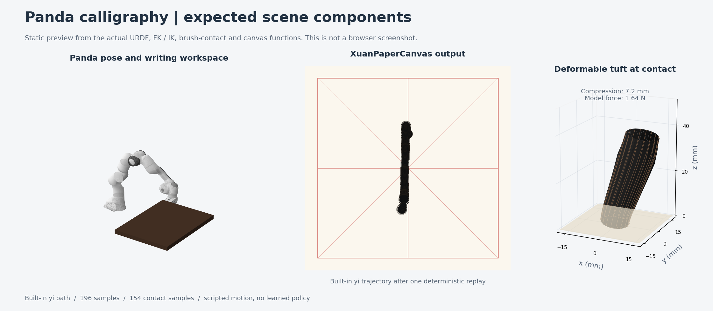

# Panda calligraphy viewer

This folder is a custom 3D add-on: a Franka Panda arm, a deformable brush mesh and an ink canvas displayed in a browser with Viser. It runs independently of the official CalliRewrite code. The official tool-aware simulation lives in [`../rl_finetune/`](../rl_finetune/); this viewer uses its own kinematics and hand-written trajectories.

**This viewer does not load the pretrained extraction checkpoints or a trained SAC policy.** Its implemented characters are `yong` (永, eight stroke groups) and `yi` (一, one stroke group). The source header also mentions 福 and 中, but they are not present in the trajectory dictionary.

## Launch with the existing environment

Run these commands in a terminal on the computer hosting the repository:

```bash
cd /data/CalliRewrite/panda_calligraphy
env -u PYTHONPATH -u PYTHONHOME PYTHONNOUSERSITE=1 \
  ./venv/bin/python -u calligraphy_panda_viser_sim.py
```

Open the HTTP URL printed by Viser, usually **http://localhost:8080**. If that port is occupied, Viser tries another port; use the URL from this run's terminal output. Successful startup prints both `URDF and meshes loaded successfully` and `[READY] Franka Panda Calligraphy Simulator is running!`.

The script has **no command-line argument parser**: there are no `--port`, `--model`, `--input` or `--help` options. Set the character and parameters in the browser. Stop the server with **Ctrl+C** in its terminal.

The command above clears inherited ROS/Conda Python paths while using this folder's Python environment. A CUDA GPU, the extraction environment and the RL environment are not required.

## What to expect

The live browser view contains the Panda robot, a dark table, Xuan paper with a red guide grid, paperweights and the brush. Orbit and zoom the 3D view to inspect the tuft and paper. Playback moves the joints through inverse kinematics; contact deforms the tuft and deposits ink on the canvas.



This is a **generated static visualization**, not a browser screenshot. It uses the actual Panda URDF and this folder's FK/IK, `RealisticDeformableTuft` and `XuanPaperCanvas` functions to replay the built-in `yi` path. The raster panel preserves the code's image-coordinate mapping. The browser also displays the interactive controls described below. See [`docs/README.md`](docs/README.md) for how the preview was produced.

For a short first run:

1. Open **Calligraphy Trajectory Execution** and press **Reset Arm Pose**.
2. Select **yi**, then press **Wash Paper (Clear)** under **Tuft & Xuan Paper Physics**.
3. Press **Execute Character (Write)** and watch the arm and ink trail. The same button pauses/resumes playback and becomes **Replay Character** after completion.
4. Try **yong** for the longer eight-group trajectory. Reset the arm and clear the paper before changing characters.

## Browser controls

| Control | Implemented behavior |
| --- | --- |
| **Character** | Selects `yong` or `yi`. Selection alone does not reset playback indices or clear the paper. |
| **Execute Character (Write)** / **Pause Writing** / **Resume Writing** | Toggles playback. |
| **Step Stroke** | Pauses, advances the stroke index and resets its interpolation position. Press Resume to play that stroke; this button does not execute an entire stroke by itself. |
| **Reset Arm Pose** | Stops playback, resets stroke indices and restores the nominal arm configuration. It does not clear ink. |
| **Writing Speed** | Changes interpolation speed from 0.2 to 3.0; default 1.0. |
| **Loop Playback** | Restarts after the last stroke and clears the canvas between loops. |
| **Tip X / Tip Y / Tip Z** | Requests a Cartesian tip position through IK while playback is paused. Negative nominal Z compresses the soft tuft against the paper. |
| **Touch Paper (Z=0)** | Despite its label, sets the requested tip Z to **0.001 m**. The paper plane is at **0.002 m**. |
| **Lift Brush (Z=35mm)** | Sets the requested tip Z to 0.035 m. |
| **panda_joint1 … panda_joint7** | Direct joint adjustment while paused, with the limits defined in the script. |
| **Bristle Stiffness** | Changes the contact-force estimate; default 1.2. |
| **Splay Factor (铺毫)** | Changes tuft expansion and contact footprint; default 1.4. |
| **Paper Absorbency** | Changes the raster bleed outline; default 0.7. |
| **Wash Paper (Clear)** | Clears ink and redraws the guide grid. |
| **Dip Ink (100%)** | Resets `ink_level`; the current drawing loop does not consume that value, so this has no visible effect. |

The contact model clamps tuft vertices to the paper plane, estimates normal force, adds motion-dependent tip lag and widens the footprint under compression. Arm motion uses position-based damped least-squares IK. This is an interactive geometric/contact demonstration; it does not run a rigid-body robot dynamics engine, torque control or robot/table collision checking.

## Inputs and outputs

The running pipeline is:

```text
built-in waypoint coordinates
  -> smooth interpolation
  -> Panda position IK and forward kinematics
  -> deformable tuft/contact estimate
  -> ink stamps on a 1024 x 1024 canvas
  -> robot, brush and paper updates in Viser
```

Only the first three values of each waypoint are used for XYZ motion. Pressing is derived from the nominal tip's height relative to the paper; the fourth waypoint value is not read by the playback loop.

There is no image/checkpoint input option and **no automatic PNG, video, trajectory or policy export**. Ink lives in memory for the current server session. The PNG in `docs/` is a documentation asset, not a file generated whenever you launch the viewer.

## Re-create the environment in a fresh checkout

The local `venv/` already exists and was used to verify startup. On another machine, use Python 3.10 and Git:

```bash
cd /path/to/CalliRewrite/panda_calligraphy
python3.10 -m venv venv
env -u PYTHONPATH -u PYTHONHOME PYTHONNOUSERSITE=1 \
  ./venv/bin/python -m pip install \
  'numpy==2.2.6' 'Pillow==12.3.0' 'viser==1.1.1' \
  'robot_descriptions==3.3.0' 'yourdfpy==0.0.60'
```

These are the principal package versions in the verified local environment; pip installs their supporting dependencies. On first startup, `robot_descriptions` downloads the Panda description and meshes into its cache, normally `~/.cache/robot_descriptions/`. This needs network access. The verified machine already had `example-robot-data/robots/panda_description/urdf/panda.urdf` cached there.

If the terminal warns that it could not load robot meshes, the brush/paper scene may still start, but the Panda arm mesh will be absent. Check the cached robot assets and the `robot_descriptions` / `yourdfpy` imports. If the page is blank or unavailable, first check the terminal for the actual port and startup errors.

## Files and verification

| File | Purpose |
| --- | --- |
| [`calligraphy_panda_viser_sim.py`](calligraphy_panda_viser_sim.py) | Server, Panda kinematics, built-in paths, canvas and browser controls. |
| [`deformable_brush_physics.py`](deformable_brush_physics.py) | Contact-dependent tuft mesh, bristle segments, force estimate and footprint. |
| [`docs/`](docs/README.md) | Expected-result image and its provenance. |
| `venv/` | Local generated Python environment; not source documentation. |
| `calligraphy_panda_viser_toolkit.zip` | Archived toolkit; the launch command above runs the current unpacked Python files. |

Verified on **2026-10-20**: the exact launch command above reached `[READY]` on port **8080** and loaded the Panda meshes with eight actuated joints. A deterministic replay through the actual IK/brush/canvas functions produced the preview image. The temporary documentation server was stopped after verification.
