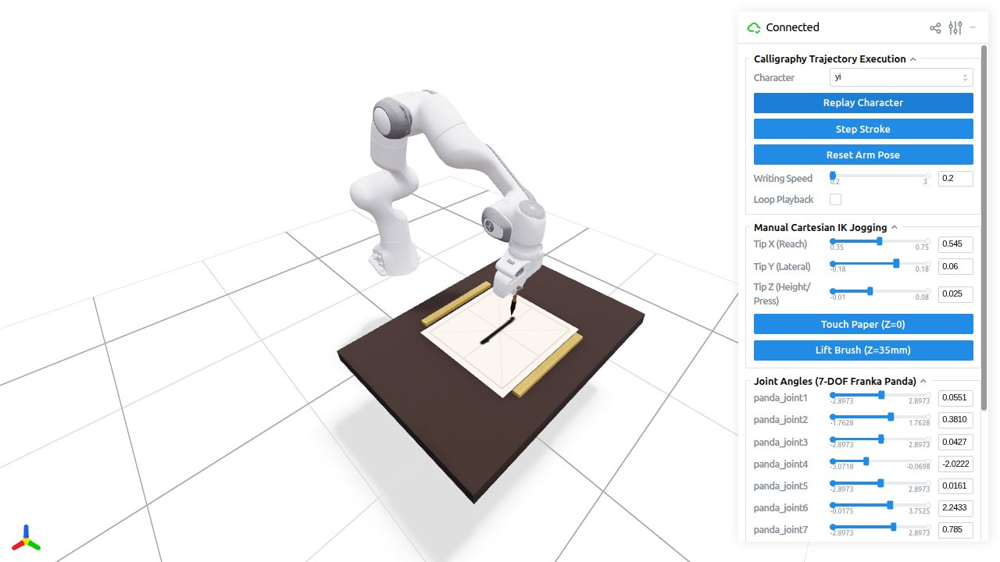

# Panda simulation visuals

These assets are embedded in the [Panda viewer README](../README.md). The `viser_yi_*` media records the actual running browser viewer. The brush explainer is generated from direct model outputs. Both demonstrate the local scripted simulator, rather than a trained CalliRewrite or SAC policy.

## Launch the live scene

```bash
cd /data/CalliRewrite/panda_calligraphy
env -u PYTHONPATH -u PYTHONHOME PYTHONNOUSERSITE=1 \
  ./venv/bin/python -u calligraphy_panda_viser_sim.py
```

Open the HTTP URL printed by Viser; it usually starts at `http://localhost:8080`, with a higher port if needed. Select **yi**, press **Reset Arm Pose**, clear the paper, set **Writing Speed = 0.2**, and press **Execute Character (Write)**. Keep **Loop Playback** off. The script has no CLI flags; all these controls are in the browser. Stop the server with Ctrl+C.

## Actual Viser `yi` recording


Captured on **2026-10-26** at the printed URL `http://localhost:8081/`, using the unmodified simulator and cached Panda robot meshes. Browser screenshots were sampled during continuous playback, then encoded at 12 fps into [the full-view MP4](viser_yi_recording.mp4). The recording lasts approximately 19 seconds, including a short completed-state hold. Completion was checked through the **Replay Character** button.

The GIF uses a 600 × 600-pixel crop of the 1280 × 720 browser view, excluding the control sidebar, at 7 fps. It preserves playback timing and shows the actual moving arm and deposited stroke.


The four panels use approximately 0.4, 3.5, 8.5 and 15.9 seconds from the recording start. These are capture-clock times, rather than internal simulation timestamps. [Capture metadata](viser_yi_capture.json) records the crop and sampling details.

Full browser context, with **yi** selected and the completed **Replay Character** state:



Other uncropped reference screenshots: [ready](viser_yi_ready.jpg), [approach](viser_yi_approach.jpg), [contact](viser_yi_contact.jpg), [sweep](viser_yi_sweep.jpg), and [lift](viser_yi_lift.jpg). Pausing the live simulation removes the motion-dependent tip lag after the next tick, so the motion frames were captured without pausing.

### Rebuild the animation and stage image

The existing MP4 is the durable source for these derived visuals. `ffmpeg` must be on PATH; the build script otherwise uses only the Python standard library:

```bash
cd /data/CalliRewrite
python3 panda_calligraphy/docs/build_viser_media.py
```

This recreates `viser_yi_drawing.gif` and `viser_yi_sequence.png` from `viser_yi_recording.mp4`. The GIF and panel crops are visual presentation changes; no robot pose, ink trail or simulation state is fabricated.

To encode a new browser capture, pass `--from-frames /path/to/capture`. That folder must contain JPEG screenshot files and `timing.json`, a list of `{"file": "frame_0000.jpg", "ms": 40}` records in capture order. The initial raw screenshots were temporary; the MP4, selected original JPEGs and metadata are retained here.

The built-in stroke runs mainly along world Y, while the canvas maps world Y to pixel rows. Its apparent direction changes with the 3D camera. The live recording preserves that camera view; the component overview below rotates the flat raster to show the stroke horizontally with explicit Panda-base axes.

## Brush deformation explainer


[Open the SVG version](brush_deformation_explained.svg) for scalable labels. The figure is a source-derived side projection of actual mesh vertices and bristle segments returned by `RealisticDeformableTuft.compute_deformation()`. It uses a vertical tool and +X motion to isolate the model's contact behavior, independently of the live Panda's changing orientation.

| Model state | Compression | Force estimate | Footprint radius | Tip lag |
| --- | --- | --- | --- | --- |
| Lifted, 8 mm above paper | 0 mm | 0 N | 0 mm | 0 mm |
| Pressed, stationary | 6 mm | 1.3025 N | 7.0053 mm | 0 mm |
| Moving +X at 30 mm/s | 6 mm | 1.3025 N | 7.0053 mm | 7.5 mm |

All examples use the source defaults: 45 mm tuft length, 7 mm root radius, stiffness parameter 1.2, splay factor 1.4, and paper plane at Z = 2 mm. Each state has 141 mesh vertices, 266 triangular faces, and 108 bristle segments. [The metrics JSON](brush_deformation_metrics.json) includes exact values and the source file hash; [the NPZ](brush_deformation_data.npz) contains the computed geometry.

The cubic spine's control points are reconstructed from the same source branches, and the diagram marks the nominal rigid tip separately from the displaced contacting tip. Loft-ring and bristle points clamp to the paper plane. The final apex is P3; the examples avoid the source's 0–0.1 mm contact deadband, where the non-contact branch can retain a nominal tip slightly below the plane. The orange footprint is the returned ink-stamp radius, not an intersection contour of the mesh.

Normal force is a model estimate, not a calibrated measurement. The stiffness parameter changes that estimate, rather than the geometry. The viewer's current RGB conversion discards the stamp's force-dependent alpha; paper absorbency changes an outline radius, without fluid simulation or ink depletion.

### Regenerate the brush diagram

From the repository root, use the existing viewer environment to evaluate the actual model and the existing RL environment to plot it:

```bash
cd /data/CalliRewrite
env -u PYTHONPATH -u PYTHONHOME PYTHONNOUSERSITE=1 \
  panda_calligraphy/venv/bin/python \
  panda_calligraphy/docs/render_brush_explainer.py \
  --plot-python /home/mihawk/anaconda3/envs/calli_rl2/bin/python
```

This regenerates the PNG, SVG, metrics JSON and mesh NPZ and validates their shapes, paper constraints and numerical formulas. No packages are installed. On another machine, `--plot-python` can name any Python interpreter with NumPy and Matplotlib.

## Component overview


`expected_simulation.png` was rebuilt on **2026-10-26** with three separately identified views:

- **Arm and table:** the 600 × 600-pixel viewport crop of `viser_yi_finished.jpg`. This uses the live viewer's rendered depth and robot/table placement, replacing the old Matplotlib robot-mesh rendering.
- **Horizontal `yi`:** the completed source replay's canvas, rotated **90° counterclockwise**. Panda base and world frames coincide. The displayed horizontal axis is **+Y_base**, spanning −0.18 to +0.18 m; the upward axis is **+X_base**, spanning 0.37 to 0.73 m. Pixel rotation maps `u' = v`, `v' = 1023 − u`, so this is an explicit coordinate view rather than a change to the robot motion.
- **Brush contact detail:** actual tuft vertices and bristle segments from the replay sample with the largest model normal-force estimate. Its axes remain millimetres relative to the contact tip.

The scene capture, completed canvas and contact detail are different moments, rather than synchronized panels. The replay uses 28 samples per waypoint segment: 196 samples in total, 154 producing contact. The contact sample has about 7.2 mm compression and a 1.64 N estimated force. [The overview metadata](overview_components.json) records the source hashes, frame orientation and paper bounds; [the data archive](overview_components.npz) contains the canvas and tuft arrays.

Regenerate the overview using the existing environments:

```bash
cd /data/CalliRewrite
env -u PYTHONPATH -u PYTHONHOME PYTHONNOUSERSITE=1 \
  panda_calligraphy/venv/bin/python \
  panda_calligraphy/docs/render_component_overview.py \
  --plot-python /home/mihawk/anaconda3/envs/calli_rl2/bin/python
```

The generator verifies the 90° pixel mapping and checks that the `yi` ink span is wider than its height. It rebuilds the PNG and overview data without changing either simulator source file. It uses the retained Viser screenshot for the left panel; the new image remains a labelled composite of real captured and computed views.
