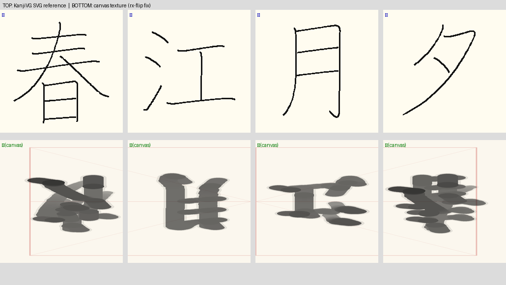
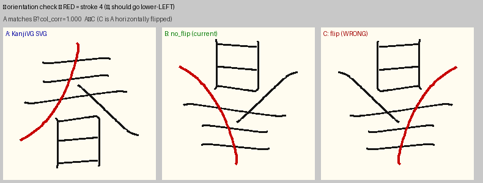

# 失败诊断示例，不是正确性证据

这两张图片来自尚未加入 Git 的本地诊断文件，原样收集，仅用于评审定位问题。**文件名和图内标签不等于验证结论。**

## 四字对照

上排是参考字形，下排实际结果未保持相同方向和字形；不能标成书写成功。此图不能证明当前分支重新运行后的行为。

## 方向对照

图 B 虽写有 “matches”，字符仍上下颠倒；相关系数高也不能排除翻转/坐标方向问题。图 C 的变换并非可直接接受的修复。需要统一 SVG、world、texture、camera 映射后重新验收。

两图的 KanjiVG 字形派生内容沿用 `../evidence/NOTICE.md` 所列 CC BY-SA 3.0 来源与声明。本次没有编辑这些原始图片，也没有伪造新的合格证据。

其余 20 张未跟踪诊断图留在原工作区，避免把重复截图作为产品成果上传。
